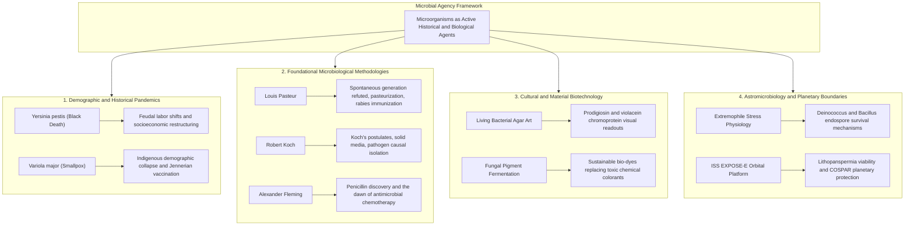

# Microbes as Agents of Change: Historical, Cultural, and Astrobiological Perspectives

[](https://github.com/ht2905/historical-microbes/actions/workflows/manuscript_ci-build.yml)
[](https://github.com/ht2905/historical-microbes/releases/latest)
[](https://github.com/ht2905/historical-microbes)

This repository hosts the manuscript source code, bibliographic database, figure assets, and automated build pipeline for an academic review paper prepared for the Microbiology (BT321IU) course at the School of Biotechnology, International University - Vietnam National University Ho Chi Minh City (VNU-HCM).

The manuscript is typeset using Quarto and the Elsevier Journal format (`elsarticle`), producing a two-column, 17-page review with complete bibliographic citations and high-resolution figures.

---

## Quick Access: Reading and Downloading the Paper

This repository is optimized for wet-lab scientists and researchers who wish to read the paper immediately without setting up computational tools or compiling code locally.

### Direct Downloads

| Deliverable | Format | Direct Repository Link | Latest CI/CD Release Build |
|---|---|---|---|
| Complete Manuscript | PDF (17 pages) | [historical-microbes_manuscript.pdf](historical-microbes_manuscript.pdf) | [Download Latest PDF](https://github.com/ht2905/historical-microbes/releases/latest/download/historical-microbes_manuscript.pdf) |
| Course Submission Cover Sheet | PDF (1 page) | [course-submission_cover-page.pdf](course-submission_cover-page.pdf) | [Download Latest Cover Page](https://github.com/ht2905/historical-microbes/releases/latest/download/course-submission_cover-page.pdf) |

### Access Options

- **Option 1: Direct PDF Reading (Recommended for Wet-Lab Scientists)**
  Download the pre-compiled [historical-microbes_manuscript.pdf](historical-microbes_manuscript.pdf) directly from the link above. No software installation, R packages, or LaTeX distributions are required.
- **Option 2: GitHub In-Browser Viewing**
  Click on [historical-microbes_manuscript.pdf](historical-microbes_manuscript.pdf) to view the formatted document directly in your browser using GitHub's built-in PDF viewer.
- **Option 3: Automated CI/CD Builds**
  Every commit to the `main` branch automatically triggers GitHub Actions to recompile the manuscript from source and update the [GitHub Releases](https://github.com/ht2905/historical-microbes/releases/latest) package with the freshest PDF binaries.
- **Option 4: Local Source Compilation**
  If you wish to modify text, re-analyze references, or render locally, follow the [Reproduction Guide](#reproduction-guide-for-local-compilation) below.

---

## Scientific Framework and Conceptual Overview

Microbiology curricula conventionally treat microorganisms either as pathogenic threats or as passive biological tools (such as *Escherichia coli* cloning vectors or *Saccharomyces cerevisiae* expression hosts). This review develops a comprehensive microbial agency framework: biological attributes—including transmission dynamics, cellular stress adaptations, metabolic pathways, and environmental resistance—actively constrain, redirect, and transform human societal institutions, material culture, and scientific paradigms.



### Manuscript Summary

| Section | Topic | Key Biological Findings and Conceptual Takeaways |
|---|---|---|
| Section 1 | Introduction | Establishes microbial biomass dominance and formalizes the microbial agency analytical framework. |
| Section 2 | Microbes that Changed History | Analyzes how *Yersinia pestis* (Black Death) forced feudal labor restructuring through zoonotic transmission kinetics, and how *Variola major* (smallpox) enabled European colonial expansion while catalyzing Jennerian immunology and global eradication. |
| Section 3 | Famous Microbiologists and Groundbreaking Discoveries | Synthesizes the transition of microbes from ambiguous environmental phenomena to identifiable, controllable entities via Pasteur (germ theory, pasteurization, attenuation), Koch (postulates and pure cultures), and Fleming (penicillin and early warnings of antimicrobial resistance). |
| Section 4 | Microbes in Art and Culture | Documents microbial pigment synthesis (prodigiosin, violacein) in agar art, eukaryotic chromoprotein expression in *E. coli*, and industrial filamentous fungal fermentation for sustainable textile dyeing. |
| Section 5 | Bacteria in Space (Astromicrobiology) | Details extremophile physiological mechanisms, 559-day Low Earth Orbit survival on the ISS EXPOSE-E facility (ADAPT project), empirical support for lithopanspermia, and COSPAR planetary protection protocols against forward contamination. |
| Appendix A | Supplementary Figures and Tables | Provides industrial scale-up fermentation schematics, textile pigment swatch assays, and comprehensive fungal dye catalogs. |

---

## Standardized Media and Figure Atlas

All figures are cataloged in `figures/` using a standardized semantic naming convention (`{entity}_{descriptor}.{ext}`):

| Filename | Description | Relevant Section |
|---|---|---|
| [`figures/black-death_transmission-cycle.png`](figures/black-death_transmission-cycle.png) | Vector-host transmission dynamics of *Yersinia pestis* involving fleas, rodents, and humans | Section 2 |
| [`figures/swan-neck-flask_pasteur-experiment.jpg`](figures/swan-neck-flask_pasteur-experiment.jpg) | Pasteur's swan-necked flask experiment disproving spontaneous generation | Section 3 |
| [`figures/microbial-art_petri-dish-display.png`](figures/microbial-art_petri-dish-display.png) | Three-row agar bio-art installation at ARTIS-Micropia (Amsterdam) | Section 4 |
| [`figures/e-coli_chromoprotein-palette.jpg`](figures/e-coli_chromoprotein-palette.jpg) | Heterologous eukaryotic chromoprotein expression palette in *Escherichia coli* | Section 4 |
| [`figures/penicillium-purpurogenum_fabric-pigments.png`](figures/penicillium-purpurogenum_fabric-pigments.png) | Red pigment dyeing assays from *Penicillium purpurogenum* on wool, silk, polyester, and viscose | Section 4 |
| [`figures/fungal-pigments_industrial-scaleup.jpg`](figures/fungal-pigments_industrial-scaleup.jpg) | Process schematic from solid-phase Petri dish isolation to liquid bioreactor fermentation | Section 4 |
| [`figures/extreme-environments_earth-cross-section.jpg`](figures/extreme-environments_earth-cross-section.jpg) | Geological crust cross-section mapping terrestrial habitats of extreme polyextremophiles | Section 5 |
| [`figures/violacein-pigment_textile-swatches.png`](figures/violacein-pigment_textile-swatches.png) | Violacein dye (*Chromobacterium violaceum*) applied with alum mordant to multiple textile types | Appendix A |
| [`figures/astromicrobiology_spaceflight-sankey-diagram.png`](figures/astromicrobiology_spaceflight-sankey-diagram.png) | Sankey diagram mapping spaceflight medical astromicrobiology risk interactions | Appendix A |
| [`figures/expose-e_orbital-facility.png`](figures/expose-e_orbital-facility.png) | ESA EXPOSE-E payload mounted to EuTEF on the International Space Station | Appendix A |

---

## Repository Structure

The repository follows a standardized faceted naming convention (`{scope}_{doc-type}.{ext}` and `{entity}_{descriptor}.{ext}`):

```text
historical-microbes-paper/
├── .github/
│   └── workflows/
│       └── manuscript_ci-build.yml           # Automated CI/CD compilation and release pipeline
├── figures/                                  # High-resolution scientific figures and schematics
│   ├── astromicrobiology_spaceflight-sankey-diagram.png
│   ├── black-death_transmission-cycle.png
│   ├── e-coli_chromoprotein-palette.jpg
│   ├── expose-e_orbital-facility.png
│   ├── extreme-environments_earth-cross-section.jpg
│   ├── fungal-pigments_industrial-scaleup.jpg
│   ├── microbial-art_petri-dish-display.png
│   ├── penicillium-purpurogenum_fabric-pigments.png
│   ├── swan-neck-flask_pasteur-experiment.jpg
│   └── violacein-pigment_textile-swatches.png
├── renv/                                     # R environment reproducibility manifests
│   ├── activate.R
│   └── settings.json
├── .gitignore                                # Version control exclusions and hygiene filters
├── _quarto.yml                               # Quarto project configuration
├── bibliography.bib                          # BibTeX literature database (Elsevier citations)
├── course-submission_cover-page.pdf          # Official assignment submission cover sheet
├── historical-microbes_manuscript.pdf        # Pre-compiled 17-page publication-grade PDF
├── historical-microbes_manuscript.qmd        # Primary manuscript source document
├── historical-microbes.Rproj                 # RStudio project configuration
├── manuscript_preamble.tex                   # LaTeX styling, URL wrapping, and float adjustments
└── renv.lock                                 # Exact lockfile recording reproducible R dependencies
```

---

## Reproduction Guide for Local Compilation

If you wish to compile the PDF on your personal workstation rather than downloading the pre-rendered copy, follow the instructions below.

### Prerequisites

| Tool | Recommended Version | Purpose |
|---|---|---|
| Quarto CLI | 1.4 or later | Scientific document processing and typesetting engine |
| R | 4.2 or later | Runtime environment for reproducible dependencies |
| TinyTeX or TeX Live | Latest | LaTeX typesetting engine generating the PDF |
| RStudio Desktop | Latest (Optional) | Integrated GUI for editing and one-click rendering |

### Step 1: Clone the Repository

Clone the repository to your local computer:

```bash
git clone https://github.com/ht2905/historical-microbes.git
cd historical-microbes
```

### Step 2: Restore Dependencies via `renv`

This repository uses `renv` to preserve exact package versions (analogous to logging reagent catalog and lot numbers in a laboratory notebook):

```bash
Rscript -e "renv::restore()"
```

In interactive RStudio, open `historical-microbes.Rproj` and execute `renv::restore()` in the R console.

### Step 3: Install Elsevier Journal Quarto Extension

Install the official Elsevier journal format extension:

```bash
quarto add quarto-journals/elsevier --no-prompt
```

### Step 4: Render the Manuscript

Compile the source document into the publication-grade PDF:

```bash
quarto render historical-microbes_manuscript.qmd --to elsevier-pdf
```

The output file `historical-microbes_manuscript.pdf` will be created in the root directory.

---

## Continuous Integration and Automated Delivery

A dedicated GitHub Actions workflow ([`.github/workflows/manuscript_ci-build.yml`](.github/workflows/manuscript_ci-build.yml)) automates quality assurance and delivery:

1. **Automated Validation:** On every pull request and push to `main`, the workflow spins up a clean Ubuntu runner, configures Quarto and TinyTeX, restores dependencies, and verifies that the manuscript builds cleanly without LaTeX or syntax errors.
2. **Artifact Packaging:** Every run uploads `historical-microbes_manuscript.pdf` as a downloadable GitHub Actions artifact.
3. **Automated Release Publishing:** Pushes to `main` update the `latest` tag on GitHub Releases, attaching both the compiled manuscript and cover page for direct one-click downloading by wet-lab collaborators.

---

## Troubleshooting Guide

| Issue | Cause | Solution |
|---|---|---|
| `LaTeX Error: File 'elsarticle.cls' not found` | The Elsevier journal extension is missing. | Run `quarto add quarto-journals/elsevier --no-prompt` in the repository root. |
| `pdflatex not found` or `xelatex not found` | No LaTeX distribution is detected on the system path. | Run `quarto install tinytex` in your terminal. |
| `there is no package called 'rmarkdown'` | Local R library has not restored lockfile dependencies. | Run `Rscript -e "renv::restore()"` to restore all required packages. |
| Figure layout or file missing error | Image paths referencing outdated folder names. | Verify that figure links point to `figures/<file>` matching the filenames in the figure atlas above. |

---

## Academic Information

- **Course:** Microbiology (BT321IU)
- **Host Institution:** School of Biotechnology, International University - Vietnam National University Ho Chi Minh City (VNU-HCM)
- **Academic Term:** Semester 1, Academic Year 2025–2026
- **Submission Date:** December 2025

### Author Contributions (CRediT Taxonomy)

| Contributor | CRediT Roles | Specific Responsibilities |
|---|---|---|
| **Tran Quoc Hoang** | Conceptualization, Methodology, Project Administration, Software, Investigation, Writing – Original Draft, Writing – Review & Editing | Conceived the study, created the Quarto pipeline, wrote Section 2 (*Pandemics*) and Section 3 (*Foundational Microbiologists*). |
| **Nguyen Hoang Tuong Vy** | Writing – Original Draft, Writing – Review & Editing | Wrote Section 5 (*Astromicrobiology*) and the Conclusion; contributed to manuscript review. |
| **Nguyen Vy Van** | Investigation, Writing – Original Draft, Writing – Review & Editing | Conducted research and wrote Section 1 (*Introduction*) and Section 4 (*Microbial Art and Culture*). |
| **Nguyen Le Ngoc Vy** | Data Curation, Visualization, Writing – Review & Editing | Co-authored Abstract, curated visual presentation materials, and participated in editorial review. |
| **Nguyen Hoang Quynh Anh** | Data Curation, Visualization, Writing – Review & Editing | Co-authored Abstract, curated visual presentation materials, and participated in editorial review. |

---

## Declarations

### Competing Interests

The authors declare that they have no known competing financial interests or personal relationships that could have appeared to influence the work reported in this paper.

### Data and Material Availability

All source code, BibTeX reference databases, and image assets are openly maintained in this repository:
[https://github.com/ht2905/historical-microbes](https://github.com/ht2905/historical-microbes)
